<a href="https://falak1720.github.io/falak-portfolio/">
  <picture>
    <source media="(prefers-color-scheme: dark)" srcset="assets/header-dark.svg">
    
  </picture>
</a>

  <picture>
    <source media="(prefers-color-scheme: dark)" srcset="assets/typing-dark.svg">
    
  </picture>

  
  
  

 

My name, **Falak**, means *sky* in Urdu. Fittingly, my research has taken me from a NASA Mars-mission simulation to 211 college students’ social media habits. I’m a psychology researcher training in **behavioral data science**: I like questions about people that can be answered with data, and answers that someone else can reproduce.

<picture>
  <source media="(prefers-color-scheme: dark)" srcset="assets/console-dark.svg">
  
</picture>

> [!TIP]
> **Open to research assistant, lab coordinator & behavioral-data roles.** The fastest way to reach me is [falak@wisc.edu](mailto:falak@wisc.edu).

## 🔭 Research

<table>
  <tr>
    <td width="33%" valign="top">
      <picture>
        <source media="(prefers-color-scheme: dark)" srcset="assets/card-social-dark.svg">
        
      </picture>
       
      Designed and ran a <b>211-participant</b> survey (Qualtrics + SONA) built from four validated scales, then analyzed it in SPSS with ANOVA, Welch’s <i>t</i>, and Spearman’s ρ.  
      <b>Finding:</b> students averaged about 4 hours a day, but usage had <i>no meaningful link</i> to social skills or offline confidence.  
      <a href="https://falak1720.github.io/falak-portfolio/docs/social-media-survey-report.pdf">Read the 40-page report →</a>
    </td>
    <td width="33%" valign="top">
      <picture>
        <source media="(prefers-color-scheme: dark)" srcset="assets/card-nasa-dark.svg">
        
      </picture>
       
      Mission-control liaison for NASA’s <b>Human Exploration Research Analog</b> Mars simulation within FUSION, a NASA-funded study (#80NSSC23K1124) of interdependent multiteam systems.  
      Managed crew communications and cross-department budget authorization during data collection.
    </td>
    <td width="33%" valign="top">
      <picture>
        <source media="(prefers-color-scheme: dark)" srcset="assets/card-tones-dark.svg">
        
      </picture>
       
      Recruited participants and collected data for a psychoacoustics study at the <b>TAP Lab</b>, measuring the minimum time gap at which listeners hear two tones as distinct.  
      Also: Army Research Institute project (coded 50+ audio recordings) and a 35+ article literature review on positive emotions and job search.
    </td>
  </tr>
</table>

## 🧪 How I work

<picture>
  <source media="(prefers-color-scheme: dark)" srcset="assets/pipeline-dark.svg">
  
</picture>

## 🧰 Toolkit

<picture>
  <source media="(prefers-color-scheme: dark)" srcset="assets/toolkit-dark.svg">
  
</picture>

## 📊 By the numbers

<picture>
  <source media="(prefers-color-scheme: dark)" srcset="assets/stats-dark.svg">
  
</picture>

## 🧠 A tiny experiment for you

<picture>
  <source media="(prefers-color-scheme: dark)" srcset="assets/stroop-dark.svg">
  
</picture>

## 📂 Projects

| Project | Question | Stack |
|---|---|---|
| [**falak-portfolio**](https://github.com/falak1720/falak-portfolio) · [live ↗](https://falak1720.github.io/falak-portfolio/) | My research portfolio and CV | HTML · CSS · JS |
| [**five-sent**](https://github.com/falak1720/five-sent) · [live ↗](https://falak1720.github.io/five-sent/) | Does a book’s cover color predict its genre? A five-sentence paper using χ² | Python · Quarto |
| [**ten-sent-corr**](https://github.com/falak1720/ten-sent-corr) | Does petal width track petal length? A correlation analysis | Python · seaborn · Quarto |

<b>🎓 Certifications &amp; honors</b>

 

- **Responsible Conduct of Research (RCR)**, CITI Program / MSU · 2025
- **Ethics and Regulations in Human Research** · 2025
- **Psychology Diploma: Anxiety & Panic Attacks** (accredited), Udemy · 2024
- **Stress & Anxiety Management** (accredited), Udemy · 2024
- **Highest Honors** and **Dean’s List every semester**, Michigan State University
- **Rashtragaan participant**, Ministry of Culture, Government of India · 2021

<b>🤝 Beyond research</b>

 

Resident Assistant for 40+ students · TA for *PSY 295: Data Analysis in Psychological Research* · English tutor (BRIDGES) · SpartanFit wellness mentor · Founding Growth & Marketing Strategist at SheVinci · Event Coordinator, Brown Girl Health Club · Inner Wheel Club volunteer

 

<picture>
  <source media="(prefers-color-scheme: dark)" srcset="assets/footer-dark.svg">
  
</picture>

<!-- Animated SVGs are generated by tools/build.py (python tools/build.py). Edit text there, not in the SVG files. -->
